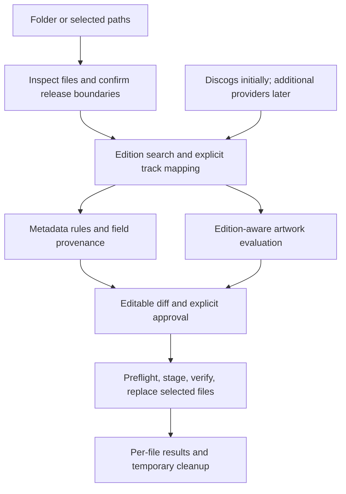

# Foobar2000 Auto-Tagger & Cover-Art Engine

## Architecture, Technical Specification & Implementation Plan

Status: agreed specification following the design review. This document describes planned behavior; implementation and provider capabilities must be verified before relying on them.

### 1. Scope and delivery

Build a semi-automated metadata and cover-art tool for electronic music releases, vinyl rips, digital releases, compilations, and eventually DJ mixes and radio shows. Every write requires review and explicit application.

The first milestone handles one release per session, FLAC files, Discogs metadata, artwork lookup, editable review, and verified writes. Launch directly with a release folder or selected file paths. Add MP3/M4A, other metadata providers, multi-release batching, and foobar2000 integration after this workflow works end to end. Defer dedicated artist-country research, audio genre classification, and radio-show handling beyond the first milestone.

### 2. Release boundaries and selection

- Treat the chosen release folder, including disc subfolders, as a proposed release. Require confirmation or correction before matching; flag apparently unrelated releases. Matching album names alone do not establish membership.
- Only selected files may be written. Sibling files may be read for context; writing them requires explicitly expanding the selection. Folder input must make the proposed file selection visible before application.
- Use the full matched edition for track positions, totals, and conditional album artist, even for a one-track selection.
- Dates and genres must be identical across the release. If applying a change would conflict with unselected sibling tracks, require expanding the selection or skipping that field. Never silently write unselected files.
- Saving a shared folder cover is a separate, visible choice.

### 3. Edition identity, matching, and evidence

Distinguish the underlying musical release from the physical or digital edition owned by the user. The selected edition anchors tracklist, catalog number, media type, and release country. Other providers may supplement fields only when their evidence applies to that edition; date handling follows section 5.

Discogs is the initial metadata source. Later integrations may use Beatport, Deezer, Bandcamp, and Apple Music where their verified capabilities are useful. Provider order must not override edition identity or the genre policy.

- Use catalog number, artist, tracklist, format, and durations together. Catalog numbers do not guarantee a unique match or a particular response time.
- Require candidate selection when multiple editions remain plausible. Offer manual search and provider URL input when automatic matching fails.
- Require unambiguous mapping of each selected file to a provider track before applying track-specific metadata. Allow manual mapping and leave unresolved tracks unchanged.
- Match using title, mix/version, duration, and position together. A duration difference within +/-5 seconds is supporting evidence, not proof or audio fingerprinting.
- Edition-specific provider evidence takes precedence over folder clues and existing tags. Show disagreements; manual overrides take precedence subject to field validation.
- Do not display numeric confidence percentages until they have a defined and tested meaning.
- Retain provider, release identifier, original source value, and transformation reason for each proposed field in the review model. Do not add provenance tags to audio files.

Folder parser example:

`[FSM005] Jason van Wyk & Audien - Someday (2011) WEB`

Extract catalog `FSM005`, artist `Jason van Wyk & Audien`, album `Someday`, year `2011`, and media type `WEB` as search clues, not verified metadata.

### 4. Metadata contract

Required means an unresolved field is flagged for review, not that a value must be invented or all other writes blocked. Missing evidence preserves existing values; unknown empty fields stay unresolved. Preserve unmanaged tags. Every replacement and deletion must appear explicitly in review.

The names below are logical foobar2000 fields; physical FLAC, ID3, and MP4 mappings must be documented and verified per format.

| Display name | Logical field | Requirement | Rule |
| --- | --- | --- | --- |
| Artist | `%ARTIST%` | Required | Preserve credited track artists, aliases, collaborators, and meaningful capitalization. Apply only conservative whitespace/punctuation cleanup. Do not split names on commas or `&` without structured evidence. |
| Title | `%TITLE%` | Required | Preserve the matched recording's title and meaningful mix/version subtitle. Do not invent `Original Mix`. |
| Album | `%ALBUM%` | Required for releases | Matched release name; may be omitted for unsorted standalone tracks in later workflows. |
| Date | `%DATE%` | Required | `YYYY`, identical across the release; section 5. |
| Style | `%GENRE%` | Required | One comma-and-space-separated text value, identical across the release; section 6. |
| Album artist | `%ALBUM ARTIST%` | Conditional | If any track credits differ, use the credited release artist, or exactly `Various` for a various-artists release. Inspect the full edition. If all track artists are identical, propose removal of existing album artist as an explicit deletion. |
| Track number | `%TRACKNUMBER%` | Required for releases | Numeric position in the full edition; section 7. May be omitted for later unsorted standalone workflows. |
| Total tracks | `%TOTALTRACKS%` | Required for releases | Full disc count for CD/DVD; full release count for vinyl and WEB. Never the selected-file count. |
| Disc | `%DISCNUMBER%` | Multi-disc CD/DVD only | Numeric disc index. Never present on Vinyl/LP or WEB. |
| Total discs | `%TOTALDISCS%` | Multi-disc CD/DVD only | Required with disc number. Never present on Vinyl/LP or WEB. |
| BPM | `%BPM%` | Requested; may be unavailable | Numeric value from applicable provider evidence. Leave unresolved if unavailable; a later external foobar BPM analysis may supplement it. |
| Label | `%LABEL%` / `ORGANIZATION` | Required when applicable | Record label. May be omitted for self-releases or an explicitly absent label; missing evidence does not justify deleting existing data. |
| Catalog # | `%CATALOGNUMBER%` | Requested; may be unavailable | Edition-specific catalog code. Folder brackets provide a clue requiring verification. |
| Release Type | `%RELEASETYPE%` | Required | Exactly one value from section 8; unresolved cases require review. |
| Release Date | `%RELEASE DATE%` | Optional | Complete `YYYY-MM-DD` only, identical across the release. No partial dates or fabricated day/month. |
| Release Country | `%RELEASECOUNTRY%` | Optional | Country of the selected edition, not a different edition's country. |
| Artist Country | `%ARTISTCOUNTRY%` | Optional | Only reliable explicit evidence about the primary act; ignore featured collaborators. Omit for multinational acts. Never infer from label/release location, names, or members' nationalities. Dedicated research is deferred. |
| Media Type | `%MEDIATYPE%` | Optional | Exactly `WEB`, `CD`, `Vinyl`, `LP`, or `DVD`; verify folder clues against the edition. |
| Disc Subtitle | `%DISCSUBTITLE%` | Optional | Verified individual CD/DVD subtitle, such as `Disc 1: Mixed`. |
| Vinyl Side | `%VINYLSIDE%` | Vinyl/LP when established | Side letter from the matched Discogs position. Flag unavailable positions as unresolved. |
| Vinyl Track# | `%VINYLTRACKNUMBER%` | Numbered vinyl positions only | Within-side numeric component; omit for side-only positions. |

### 5. Release-wide dates

Dates describe the release, not individual tracks. All tracks share the same `%DATE%` and, when known, complete `%RELEASE DATE%`.

- A reissue with the same recordings and tracklist retains the original release date. Packaging, format changes, and remastering alone do not reset it.
- Added tracks, substituted recordings, or new mixes make a distinct release using its own release date.
- Example: a 2020 edition adding a remix first released in 2005 to a release originally issued in 1998 uses 2020, not 1998 or 2005, for every track.
- If only the year is supported, write `%DATE%=YYYY` and leave an empty `%RELEASE DATE%` unset. Preserve and flag an existing disputed value rather than silently clearing it.
- Never invent a day/month or store `YYYY` / `YYYY-MM` in `%RELEASE DATE%`. Existing invalid partial values must be exposed for explicit correction or deletion.
- Apply the partial-selection consistency rule in section 2.

### 6. Release-wide Discogs-style genres

Store one text value in `%GENRE%`, separated by comma and space. Preserve source order and remove duplicates. Every track in a release receives the same genre list, for example:

`Trance, Progressive Trance, Progressive House, Tech Trance`

- Use all styles from the matched Discogs edition and apply them to all tracks. No track-level style attribution is needed.
- Discogs styles take precedence. Do not automatically add store-derived styles to a populated Discogs list.
- Only when Discogs styles are unavailable, use store categories through explicit user-controlled mappings.
- Approved initial mapping: `Melodic House & Techno` -> `Progressive House`. The source category must never pass through unchanged into genre tags.
- Other categories without an approved mapping remain unresolved until reviewed. Do not guess a conversion.
- Maintain a configurable vocabulary of accepted Discogs-style names. Validate both provider suggestions and manual edits; vocabulary changes are deliberate.
- No automatic audio genre inference in the first milestone.
- Genre changes require explicit style selection and must respect release-wide consistency and selected-file boundaries.

### 7. Track, disc, and vinyl numbering

CD/DVD numbering restarts per disc; `%TOTALTRACKS%` counts tracks on that disc. Only multi-disc CD/DVD releases receive `%DISCNUMBER%` and `%TOTALDISCS%`.

Vinyl/LP numbering runs continuously across the entire release, including multi-record sets. `%TOTALTRACKS%` is the full release count. Vinyl must never have disc-number or total-disc tags; propose explicit deletions if those fields already exist.

Follow the matched Discogs tracklist for side positions:

| Discogs position | `%VINYLSIDE%` | `%VINYLTRACKNUMBER%` |
| --- | --- | --- |
| `A` | `A` | Omitted |
| `B` | `B` | Omitted |
| `A1` | `A` | `1` |
| `A2` | `A` | `2` |
| `B1` | `B` | `1` |

For `A1, A2, B1, C1, D1`, ordinary track numbers are `1, 2, 3, 4, 5` and total tracks is `5`. For `A, B`, ordinary track numbers are `1, 2`; vinyl track numbers are omitted. Never generate uncertain side positions from file order. Allow manual correction and flag unresolved positions without blocking independent changes.

### 8. Release classification

Preserve exactly these 14 values:

```python
VALID_RELEASE_TYPES = [
    "Single",
    "Sampler",
    "EP",
    "Album",
    "Compilation",
    "Album, Mixed",
    "DJ Mix",
    "Compilation, Mixed",
    "Radioshow",
    "Radioshow, Live Mix",
    "Live Mix",
    "Mixtape",
    "Sampler, EP",
    "EP, Mixed"
]
```

Explicit classification for the matched release takes precedence when it maps clearly to this vocabulary. Show the classification reason. Track count and duration are fallback clues, not mandatory overrides:

- One or two tracks may suggest `Single`.
- Three to six tracks under 30 minutes may suggest `EP`.
- More than six tracks by one artist may suggest `Album`.
- A various-artists collection may suggest `Compilation`; an upcoming-release promotional selection may suggest `Sampler` or `Sampler, EP`.
- Explicit continuous/DJ mixing evidence may support `DJ Mix`, `Compilation, Mixed`, `Album, Mixed`, or `EP, Mixed`, according to release structure.
- Radio-show and event evidence may support `Radioshow`, `Radioshow, Live Mix`, or `Live Mix` in later workflows. Show names alone are clues.
- Use `Mixtape` only with supporting classification evidence or manual selection.

Leave conflicting or uncovered cases, such as a four-track 45-minute release, unresolved rather than forcing a heuristic answer. Do not infer seamless mixing merely from adjacent track durations.

### 9. Artwork contract and pipeline

Artwork identity precedes size and provider preference. Prefer images depicting the selected edition. Offer other-edition artwork only as a clearly labeled alternative requiring selection.

1. Inspect embedded and folder images. Existing artwork is unverified until its identity is established; dimensions alone do not justify automatic acceptance. Allow the user to retain it; never silently replace it.
2. Search for edition-appropriate candidates using available providers. Prefer clean, uncropped artwork with useful native resolution. Provider and PNG/JPEG preference are secondary when quality is otherwise comparable.
3. Require both dimensions to be at least 1000 pixels and final encoded size strictly below **5,000,000 bytes**. Preserve aspect ratio and prohibit upscaling.
4. Try lossless optimization, then JPEG conversion or downscaling while maintaining the minimum dimensions. Measure the actual encoded output; a response header alone cannot establish compliance. Do not describe lossy palette quantization as lossless optimization.
5. If no candidate qualifies, leave replacement artwork unresolved and allow metadata-only application. An explicitly retained existing image may remain without being described as compliant.
6. Save PNG bytes as `cover.png` and JPEG bytes as `cover.jpg`. Show exact files to replace or remove, including different-extension covers. Do not silently leave conflicting old and new covers.
7. Folder-cover writes are independently selectable. Optional embedding must be explicit and limited to selected audio files, subject to the same review and write safeguards.

Apple Music high-resolution URL variants may be investigated during implementation. Do not assume a URL size/extension substitution proves native resolution, original studio-master provenance, or a guaranteed PNG response. Decode and inspect actual results. Integration availability and provider capabilities must be validated; this plan makes no guaranteed resolution, latency, or access claims.

### 10. Review, failures, and application

Provide a responsive dark-themed Tkinter window with:

- Confirmed edition and file selection, full track mapping, and candidate switching/manual search.
- Side-by-side existing/proposed values, editable cells, per-field selection, and clearly marked additions, replacements, and deletions.
- Visible provider disagreements, source provenance and transformation reasons, classification rationale, and unresolved fields.
- Current/proposed artwork previews, dimensions, encoded bytes, edition identity status, and affected cover paths.
- Separate metadata, folder-cover, and embedding choices; metadata-only and artwork-only application.

Apply remains available for independently verified and approved fields while clearly listing unresolved fields that will remain unchanged. Timeouts, unavailable providers, or missing compliant artwork do not block unrelated changes. Show failures and offer retry. Never silently substitute a weaker release match.

Write procedure:

1. Preflight selected paths, permissions, and space for temporary files. Record file state when review data is read; detect external changes again before replacement. If another application modified a file during review, refuse that write and refresh its comparison.
2. Prepare each modified audio file in a temporary sibling file. Write with Mutagen, reopen it, and verify intended tags and preservation of unmanaged metadata before replacing the original.
3. Replace the original using a same-filesystem atomic replacement where supported. Stage and validate artwork before replacing approved cover paths as well.
4. Clean up temporary files automatically after success. After interruption, report leftovers and offer cleanup. Keep no persistent audio backups and no backup-removal burden for the user.
5. Report exactly which files and fields changed, failed, or were skipped. Multi-file application is not a single atomic transaction and can finish partially. Do not promise release-wide rollback or restoration of already replaced files without backups. After partial failure, flag any resulting release-wide date/genre inconsistency and offer retry/review.

Never write a personal library while developing the writer; validate against disposable audio fixtures first.

### 11. Architecture and planned structure

Keep provider access, matching/normalization, review state, artwork handling, and file writes separate. The UI approves a concrete changeset; providers must not write files directly.



Planned layout (not yet an executable interface):

```text
main.py                    # Direct launch first; aggregation later
config.py                  # Thresholds, accepted styles, mappings, configuration
providers/
    base.py                # Shared provider boundary
    discogs.py             # Edition search and metadata
    apple_music.py         # Artwork lookup, validated capabilities
    beatport.py            # Later metadata enrichment and mapped categories
    deezer.py              # Later enrichment/artwork
    bandcamp.py            # Later underground/self-release support
core/
    clue_parser.py         # Folder/file clues, not authoritative tags
    matching.py            # Edition identity and track mapping
    rules_engine.py        # Dates, genres, artists, classification, numbering
    cover_engine.py        # Identity-aware candidate evaluation and encoding
    tag_writer.py          # Selected-file staging, validation, replacement
ui/
    app.py                 # Session, release selection, review and results
    diff_table.py          # Editable field comparisons and provenance
    artwork_panel.py       # Image comparisons and output choices
tests/                     # Synthetic fixtures and disposable audio copies
Tag_Selection.bat          # Later foobar2000 launcher
```

Keep API credentials outside tracked files; configuration may reference environment variables or external credential storage. When adding runnable code, document dependencies, isolated environment setup, launch commands, and the test command alongside project configuration.

### 12. Roadmap

**Milestone 1: One-release FLAC workflow**

- Direct folder/path launch; confirm grouping and selected files.
- Discogs edition search, URL/manual selection, track mapping, and source provenance.
- Folder clues, release-wide dates and genres, artist credits, conditional album artist, classification, and CD/DVD/vinyl numbering rules.
- Artwork lookup and review using available verified provider capabilities, with identity and output validation. Missing qualifying art must not block metadata.
- Editable Tkinter review and independent output choices.
- Safe temporary-file writes and accurate partial-failure reporting on disposable FLAC fixtures.

**Milestone 2: Formats and provider enrichment**

- MP3 ID3v2.4 and M4A/MP4 mappings with verified foobar2000 interoperability.
- Additional metadata providers and configurable explicit style mappings; preserve edition and Discogs-style precedence.
- Expanded mixed-release/radio-show support and dedicated artist-country research.

**Milestone 3: foobar2000 integration and batching**

- `Tag_Selection.bat` / `foo_run` context-menu launch.
- Validate selection argument handling and multi-process queue aggregation. Investigate the `foobar-dedupe` pattern if available; 350 ms is a candidate batching window to test, not a correctness guarantee.
- Multi-release sessions with explicit grouping and independent review.
- Verify the supported foobar2000 metadata-reload mechanism before documenting an exact command. Refresh successfully changed files and report refresh failures separately from successful writes.

### 13. Verification and acceptance

Use focused tests under `tests/test_<feature>.py`, mocked provider responses, small synthetic fixtures, and temporary disposable audio copies. Do not commit music libraries, credentials, or downloaded artwork.

Milestone 1 acceptance requires an end-to-end demonstration of matching, editable review, selected-file boundaries, release-wide dates/genres, artwork validation, and verified FLAC writes with cleanup, plus these focused cases:

- Folder parsing and unrelated-release detection; sibling inspection without unauthorized writes.
- Ambiguous edition candidates, manual mapping, version/duration disagreements, and unresolved tracks left unchanged.
- Unchanged reissue versus added/substituted material; year-only knowledge, rejection of partial exact dates, and consistent dates across tracks.
- Discogs style ordering/deduplication, single-text comma serialization, approved store mapping, unmapped categories, manual vocabulary validation, and partial-selection genre conflicts.
- Full-edition conditional album artist; exactly `Various`; visible album-artist deletion when credits are identical.
- Multi-disc CD/DVD totals, continuous multi-record vinyl numbering, side-only versus numbered positions, missing side evidence, and explicit removal of vinyl disc tags.
- Classification precedence, all 14 accepted values, and unresolved heuristic gaps.
- Artwork edition mismatch, unverified existing images, prohibited upscaling, dimensions below 1000 on either axis, exactly 5,000,000 bytes rejected, compliant encoding, format/extension agreement, and cross-extension cover replacement review.
- Provider outages, retry, missing artwork, independent output application, and preservation of unmanaged tags and unresolved existing values.
- External modification during review, insufficient space/permissions, interrupted staging, failed verification/replacement, temporary cleanup, and exact partial-completion reporting without persistent backups.

Validate manual launching before foobar2000 integration. For UI changes, retain screenshots demonstrating review behavior. Later formats and integrations require their own disposable-fixture interoperability checks.
